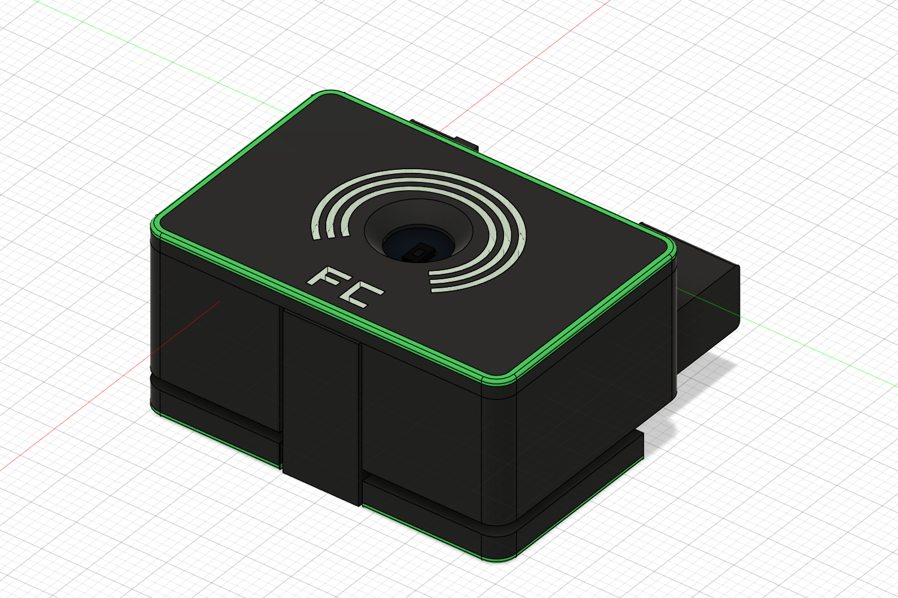

# FC 传感器外壳

Version: L7
Tag: L7

ESP32-C3 SuperMini 与 BH1750 背靠背安装的显示器顶部折叠外壳。当前为 40 mm 加宽、内套圈定位、内部藏胶槽方案，黑绿主体配透明图案。

主模型：[model.f3d](model.f3d)。当前原生装配包含隐藏历史/参考组件，保留建模依赖；导出打印件时仅选本版底壳、上盖、折叠脚与前挡板。部分前挡板/图案组件沿用旧名称，不代表应打印所有隐藏旧件。

## 预览

**三视图待补**：现有图是透视装配/分体图，尚无正交三视图。下一次正式发布前在 Fusion 导出 images/three-view.png。

## 参考资源与说明

- [ESP32-C3 SuperMini](../assets/esp32-c3-supermini/)：C3 板卡参考。
- [BH1750 / GY-302](../assets/bh1750-gy302/)：光照模块参考。
- [装配说明](ASSEMBLY.md)：尺寸、定位、转轴、胶接及打印摆放。
- 接线说明：尚未整理；需要时增加本目录 WIRING.md，并以实际固件引脚和模块丝印核对，不从几何模型推断线序。

F3D 已嵌入的参考组件保持不变。assets 为共享参考入口，不意味着本次已重新链接或更新 Fusion 内的组件。

## 验证状态

历史记录：静态与 PCB 干涉、分段插盖、0–90° 每 3° 转动采样、四件单色网格检查通过。不是对所有中间位置的连续验证。**L7 实物打印、套口、胶接、螺纹耐久仍待验证**。本次整理未重新运行 Fusion 或切片。

[原始检查、打印导出及脚本](https://github.com/chuanjianghe1024-cmd/fc-sensor-models/tree/bd3a33ef6047b93d584d7ea6c29092cb1b13ddc1/03_FC传感器外壳/当前版本_L7_加宽套口藏胶)。通用 3MF 不等同于已配置拓竹机型/AMS 的工程。

## 更新日志

### 2026-10-31 — 项目与资源分离
项目移至根目录 fc-enclosure；参考模块统一移入 assets；装配说明独立到 ASSEMBLY.md。几何不变。

### 2026-10-31 — 仓库整理（几何不变）
统一 model.f3d 与固定预览路径，移除工作树中的版本副本和重复导出。保留 L6/L7 原 tag，不新建几何版号。

### L7 — 2026-10-26
宽度 36→40；取消卡扣，改内套圈和隐藏胶槽；保留光孔/PCB位置、支撑压条、配色和螺丝有效跨度。实物待验证。[历史 tag](https://github.com/chuanjianghe1024-cmd/fc-sensor-models/tree/L7)。

### L6 — 原型基线
单件平底、已有第一台实物原型反馈；[历史 tag](https://github.com/chuanjianghe1024-cmd/fc-sensor-models/tree/L6)。历史图片和打印工程保留在该快照。
