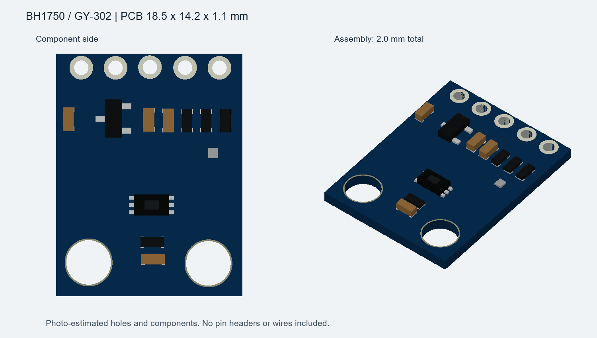

# BH1750 / GY-302 V322

Version: legacy-reference
Tag: none

用于 FC 外壳装配占位的光照模块参考。唯一主文件 [model.step](model.step)，单位 **mm**。尚无独立 Fusion 原生文件，暂作为迁移例外保留 STEP。

## 尺寸与来源

用户实测 PCB 18.5×14.2，厚 1.1，含元件总厚 2.0。元件面照片左下角为原点，X 沿宽度、Y 指向五孔排、Z 指向元件。孔径/孔位/小元件尺寸依据照片估算，不可当作加工级数据；不含排针、焊点和飞线。

模型由旧建模脚本按实测包络及照片构建；原参数、脚本、实物照片保留在[整理前目录](https://github.com/chuanjianghe1024-cmd/fc-sensor-models/tree/bd3a33ef6047b93d584d7ea6c29092cb1b13ddc1/02_BH1750-GY302光照模块)。装配时不随意镜像或改变原点。

## 验证与待补

历史参数记录 STEP 往返校验通过，包络 14.2×18.5×2.0，55 个组件；本次未重跑。当前预览非三视图。正式发布前在 Fusion 导入、核对、导出唯一 model.f3d，补真实 images/three-view.png 和 images/exploded.png 后替代 STEP。模块若无可拆分件，分体图位置可用部件展示并注明。

## 更新日志

### 2026-10-31 — 整理
保留一个 STEP 主模型及一张外观图；其余资料从 Git 历史追溯，几何不变。未发布独立 tag。
