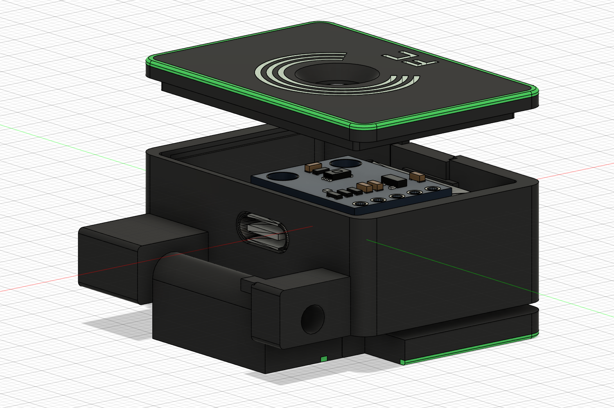

# FC 传感器外壳

Version: L7
Tag: L7

ESP32-C3 SuperMini 与 BH1750 背靠背安装的显示器顶部折叠外壳。当前为 40 mm 加宽、内套圈定位、内部藏胶槽方案，黑绿主体配透明图案。

主模型：[model.f3d](model.f3d)。当前原生装配包含隐藏历史/参考组件，保留建模依赖；导出打印件时仅选本版底壳、上盖、折叠脚与前挡板。部分前挡板/图案组件沿用旧名称，不代表应打印所有隐藏旧件。

## 预览

**三视图待补**：现有图是透视装配/分体图，尚无正交三视图。下一次正式发布前在 Fusion 导出 images/three-view.png。

## 尺寸与装配约束

- 单位 mm；沿用 F3D 原坐标，禁止随意移动参考板。
- C3 PCB 22.5×17.8，含 USB 长 23.5；BH1750 为 18.5×14.2。飞线、焊点与绝缘层另留空间。
- 底壳含轴座包络 37.3×40×13.8；上盖平面 27×40；闭合装配高度约 20。
- BH1750 横置于 C3 背面；光孔对感光芯片而非 PCB 中心。孔/芯片中心 X=11.771、Y=11.195，芯片顶到盖内面约 0.42。
- 保留四角支撑、侧向限位、USB 对侧盖内压条。套圈壁厚约 1、插入 1.5、每侧间隙 0.25。
- 两侧内部胶槽各长 19、高 0.7、深 0.35，距外缝留 0.55 挡胶边。先干装，合格后少量涂胶，避免污染感光面/USB/轴。
- 单颗 M3×30 内六角圆柱头螺丝，头下长度 30，无螺母；活动孔 Ø3.4、塑料底孔 Ø2.7，计算啮合约 4.10；开角 0–90°。
- 打印：底壳/脚平底朝下，前挡板侧放，上盖外观面朝下套圈向上；复核桥接、USB 顶部、轴孔及多色映射。

## 验证状态

历史记录：静态与 PCB 干涉、分段插盖、0–90° 每 3° 转动采样、四件单色网格检查通过。不是对所有中间位置的连续验证。**L7 实物打印、套口、胶接、螺纹耐久仍待验证**。本次整理未重新运行 Fusion 或切片。

[原始检查、打印导出及脚本](https://github.com/chuanjianghe1024-cmd/fc-sensor-models/tree/bd3a33ef6047b93d584d7ea6c29092cb1b13ddc1/03_FC传感器外壳/当前版本_L7_加宽套口藏胶)。通用 3MF 不等同于已配置拓竹机型/AMS 的工程。

## 更新日志

### 2026-10-31 — 仓库整理（几何不变）
统一 model.f3d 与固定预览路径，移除工作树中的版本副本和重复导出。保留 L6/L7 原 tag，不新建几何版号。

### L7 — 2026-10-26
宽度 36→40；取消卡扣，改内套圈和隐藏胶槽；保留光孔/PCB位置、支撑压条、配色和螺丝有效跨度。实物待验证。[历史 tag](https://github.com/chuanjianghe1024-cmd/fc-sensor-models/tree/L7)。

### L6 — 原型基线
单件平底、已有第一台实物原型反馈；[历史 tag](https://github.com/chuanjianghe1024-cmd/fc-sensor-models/tree/L6)。历史图片和打印工程保留在该快照。
